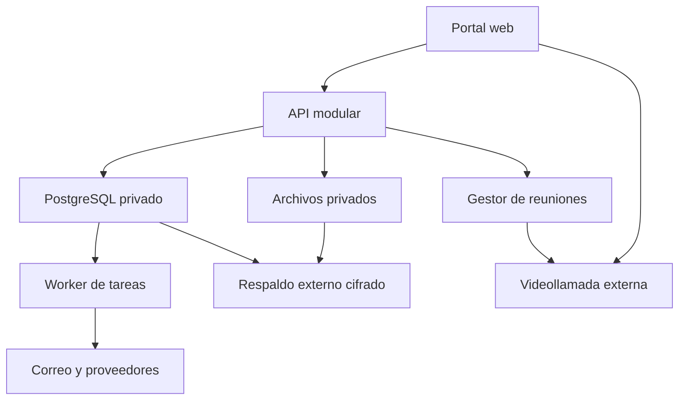

# Arquitectura propuesta

## Decisión de conjunto

Un repositorio propio con una web responsive, una API de dominio modular, un worker y PostgreSQL. Los módulos de clínica, agenda y pagos comparten un modelo transaccional, pero cada uno es responsable de sus reglas. Esto permite implementar un flujo completo sin operar un servicio independiente por cada módulo.

Se propone TypeScript, Next.js, NestJS, PostgreSQL y Prisma. Las versiones se seleccionan al iniciar, verificando soporte y compatibilidad; no se adoptan automáticamente las versiones de documentos históricos. Next.js dispone de instrucciones oficiales de autoalojamiento y NestJS permite organizar la aplicación por módulos. [T1, T2]

## Componentes

| Componente | Tecnología propuesta | Responsabilidad |
|---|---|---|
| Web | Next.js y TypeScript | Portales del paciente, profesional, recepción y dirección. |
| API | NestJS | Autorización, reglas de negocio y contratos HTTP. |
| Persistencia | PostgreSQL | Integridad de pacientes, casos, citas, notas, pagos y auditoría. |
| Acceso a datos | Prisma más migraciones SQL explícitas cuando proceda | Consultas, transacciones y restricciones que no exprese el ORM. |
| Trabajo asíncrono | Worker del mismo proyecto | Recordatorios, generación de documentos y reintentos de integraciones. |
| Cola inicial | Outbox y trabajos persistentes en PostgreSQL | Entrega repetible sin añadir otro servicio por defecto. |
| Archivos | Almacenamiento privado compatible con S3 o volumen protegido con respaldo externo | Consentimientos, documentos y adjuntos. Elegir tras evaluar región y contrato. |
| Video | Meet o Zoom por enlace inicialmente | Transporte de audio y video fuera del VPS clínico. |
| Operación | Docker y Coolify en OVH | Despliegue reproducible, rutas HTTPS, límites y reinicios. |

Redis y BullMQ pueden añadirse si el volumen de trabajos o la reutilización técnica real lo justifican. Si se elige una cola basada en PostgreSQL, usar una biblioteca mantenida o una implementación pequeña y revisada: reclamación atómica, visibilidad, reintentos, deduplicación y recuperación. La reducción de componentes no autoriza perder recordatorios al reiniciar.

## Diagrama lógico

El esquema es conceptual. El usuario participa en el servicio de video y la aplicación intercambia metadatos mínimos. La aplicación no recibe ni almacena el audio y video de la sesión en este diseño inicial.

## Límites de módulos

- **Identidad y autorización:** cuentas, sesiones, recuperación, MFA y capacidades. Una cuenta no es una historia clínica.
- **Personas y casos:** identidad, participantes, representación y asignaciones vigentes.
- **Agenda:** disponibilidad, reservas, recursos, cancelaciones y reprogramaciones.
- **Clínica:** encuentros, plantillas, notas, validación, adendas, consentimientos y acceso a documentos.
- **Equipo y prácticas:** profesionales, pasantes, periodos, supervisión, horas y evaluación.
- **Finanzas:** obligaciones, pagos, conciliación, ajustes, becas, donaciones y liquidaciones.
- **Integraciones:** video, correo, pagos y emisión de comprobantes, con adaptadores sustituibles.
- **Auditoría y operación:** evidencia de accesos, acciones críticas, errores y continuidad.

Una operación de dominio debe mantener sus invariantes dentro de la transacción. Los efectos externos se emiten después del commit mediante outbox, con clave de idempotencia. Si el proveedor falla, la cita conserva un estado realista como reunión pendiente de creación; no se inventa un enlace exitoso.

## Estructura de repositorio que se propone crear

- `apps/web`: interfaz y accesibilidad.
- `apps/api`: módulos de dominio, autorización y contratos.
- `apps/worker`: entrada del proceso de trabajos con servicios compartidos.
- `packages/contracts`: esquemas o cliente generado de OpenAPI.
- `packages/config`: configuración común estrictamente necesaria.
- `database`: esquema, migraciones y datos ficticios.
- `docs`: decisiones, producto, pruebas y operación.
- `infra`: Docker, configuración de despliegue y runbooks sin secretos.

Un workspace pnpm es suficiente como punto de partida. No es necesario añadir Nx o Turborepo solo por coherencia visual con otros repositorios; la decisión depende de las tareas y dependencias reales.

## Decisiones que evitan fallos costosos

### Autorización en cada lectura y escritura

La API evalúa la cuenta, capacidad, ámbito, período y operación. El acceso clínico del equipo requiere una asignación vigente; el paciente accede por identidad y participación, un representante por acreditación y alcance, y recepción o finanzas por capacidades administrativas sin lectura clínica. No se crean asignaciones clínicas artificiales para estas funciones. Las búsquedas, listados, conteos, descargas y exportaciones aplican el mismo predicado que su operación de origen. Desactivar una asignación debe invalidar el acceso clínico correspondiente, aunque exista una sesión iniciada.

Las rutas clínicas envían cabeceras de no almacenamiento y no se renderizan como contenido público estático. No guardar datos clínicos ni tokens de sesión en `localStorage`. Revisar cachés de Next.js, proxy, CDN y navegador. Una cookie segura con atributos apropiados, protección CSRF y controles de sesión se configura junto con una biblioteca de autenticación mantenida; no crear criptografía ni protocolos de autenticación propios.

### Reservas concurrentes

La comprobación visual de disponibilidad es informativa. La confirmación debe ser atómica. PostgreSQL soporta rangos y restricciones de exclusión para impedir solapamientos; se puede usar esta capacidad junto con un modelo de reservas por profesional y recurso. [T3]

Definir intervalos semiabiertos, margen entre consultas, expiración de reservas temporales y estados que bloquean horario. Las migraciones necesarias pueden incluir SQL aunque el ORM no modele la restricción. Probar dos reservas simultáneas contra PostgreSQL real.

### Integridad clínica y económica

Usar control de concurrencia para evitar que dos ediciones se sobrescriban. Una nota validada es inmutable desde las operaciones normales de la aplicación y las correcciones enlazan a la versión anterior. Diseñar auditoría protegida, con acceso restringido y conservación específica; no afirmar inmutabilidad criptográfica si no se implementa.

Las referencias de pago y eventos externos tienen unicidad cuando corresponda. Los importes se representan con exactitud, las devoluciones son ajustes enlazados y una liquidación conserva la versión del acuerdo utilizado. No calcular saldos sumando estados de citas.

### Datos sensibles y archivos

Aplicar HTTPS, cifrado de discos o almacenamiento según la solución elegida, respaldo cifrado y permisos mínimos. Evaluar cifrado de campos especialmente sensibles mediante bibliotecas probadas y gestión de claves recuperable. Las claves deben tener custodia separada de los respaldos de datos y un procedimiento de recuperación verificado.

Los archivos requieren límites de tamaño y tipo, verificación de contenido, cuarentena o análisis cuando corresponda, almacenamiento no ejecutable y autorización de descarga. Los registros técnicos no contienen cuerpos clínicos ni secretos. La auditoría registra acción, actor, recurso, fecha y motivo relevante sin copiar el relato.

### Aislamiento operativo

Crear un proyecto de Coolify, redes, volúmenes, usuarios de base de datos, buckets o prefijos y secretos exclusivos. Un host compartido sigue siendo un dominio común de fallo; no equivale a alta disponibilidad ni a separación física. Un VPS separado puede resultar preferible para datos clínicos si el host actual no tiene margen o el riesgo de convivencia es excesivo.

Medir la capacidad real del servidor antes de desplegar y confirmar que dispone del margen necesario. No eliminar imágenes, backups o contenedores ajenos para crear espacio.

## Despliegue y recuperación

Desarrollo local y demostración sintética primero. Staging y producción usan datos, claves y recursos distintos. No es necesario mantener varios stacks encendidos si no hay capacidad; la separación lógica no depende de que todos estén activos continuamente.

Publicar únicamente la entrada HTTPS de la aplicación. La base de datos permanece privada. Usar proxy inverso, límites de carga, health checks y configuración explícita del entorno. El build puede ejecutarse en CI y producir una imagen versionada, evitando consumir el margen del VPS. [T1]

Planificar respaldo externo de PostgreSQL, archivos y material de recuperación de configuración y claves. El respaldo del propio Coolify no reemplaza el respaldo de los datos de la aplicación. Una copia debe restaurarse y leerse con la aplicación antes de declararla recuperable. [T4]

El rollback de una imagen no revierte automáticamente una migración destructiva. Preferir cambios compatibles y ensayar recuperación para cambios de esquema relevantes. Los objetivos iniciales de pérdida tolerable y recuperación se acuerdan con David y se miden; no prometer disponibilidad contractual sin operación que la sostenga.

## Integración futura con proveedores externos

Un proveedor de recursos psicoeducativos podría aportar contenidos mediante enlaces o una integración voluntaria acotada en el futuro. El expediente clínico, la identidad y las finalidades de tratamiento requieren límites explícitos. No conectar historias, diarios o mapas emocionales por compartir infraestructura o tecnología.

Un proveedor de facturación electrónica puede evaluarse cuando su servicio esté operativo y sea adecuado a la entidad que factura. El contrato de integración debe recibir datos fiscales mínimos y devolver estado/documento autorizado. No condicionar la primera agenda a construir un sistema tributario completo.

## Fuentes

- [T1 Next.js y autoalojamiento](https://nextjs.org/docs/app/guides/self-hosting).
- [T2 Módulos de NestJS](https://docs.nestjs.com/modules).
- [T3 Rangos y restricciones de exclusión de PostgreSQL](https://www.postgresql.org/docs/current/rangetypes.html).
- [T4 Backups de bases de datos en Coolify](https://coolify.io/docs/databases/backups).

Fuentes públicas consultadas el 23 de noviembre de 2026. La propuesta no fija versiones de dependencias ni afirma acceso autenticado al servidor.
